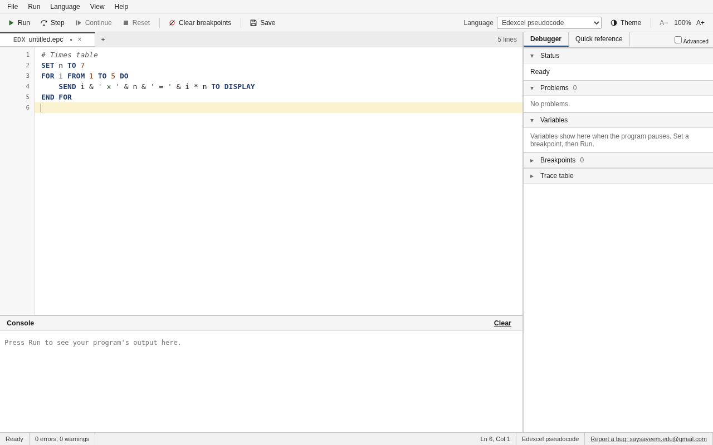
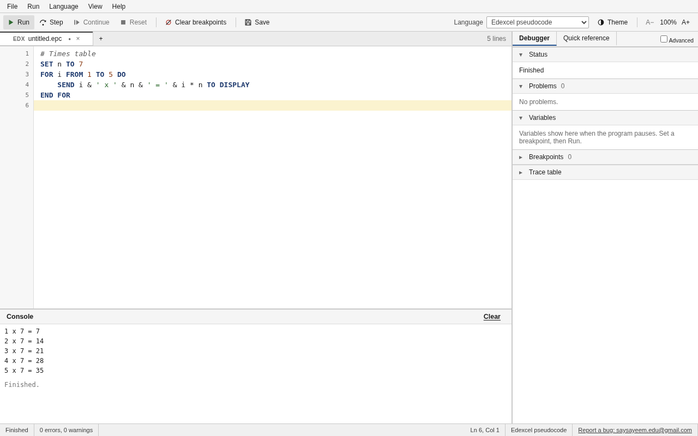
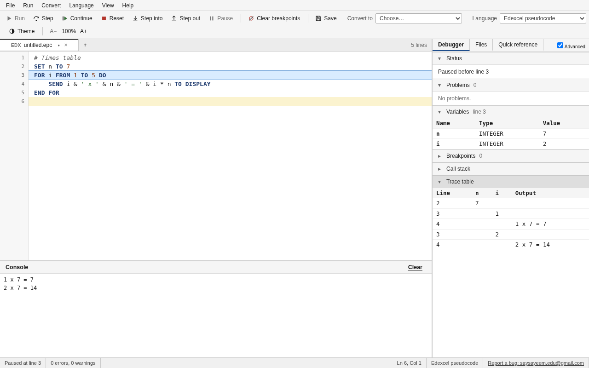
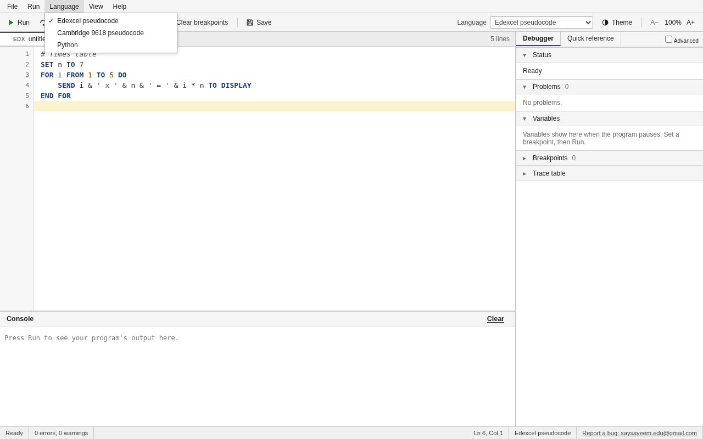
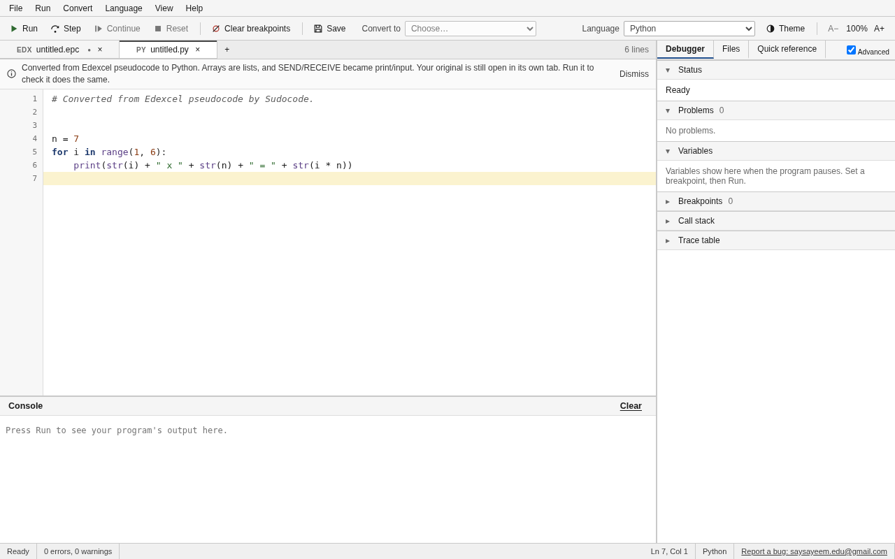
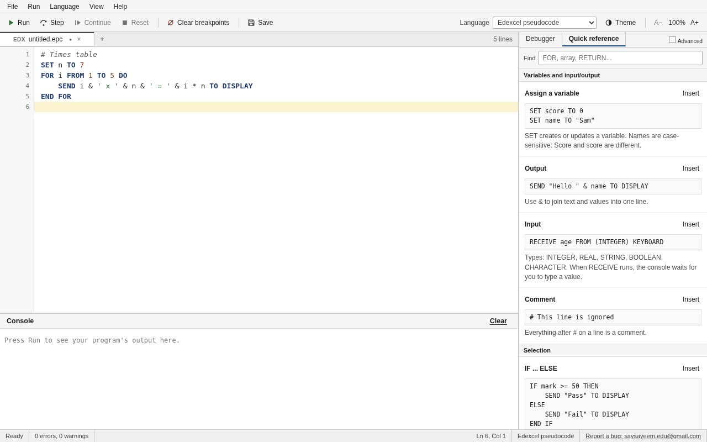
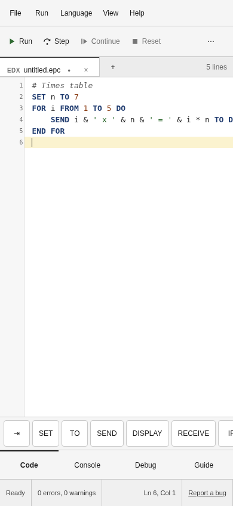
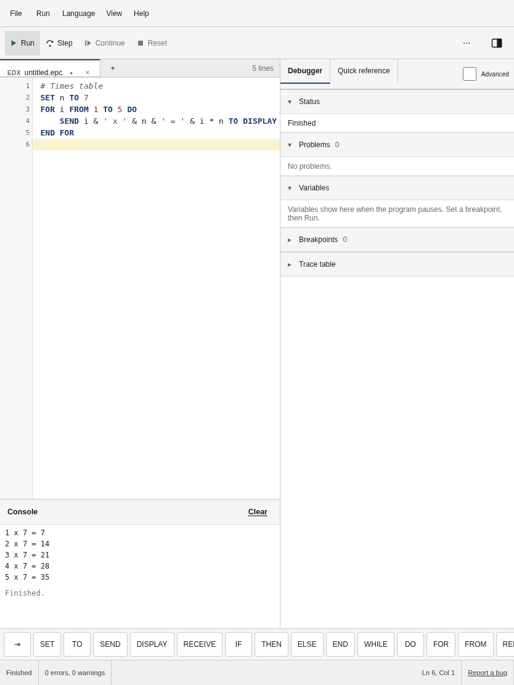
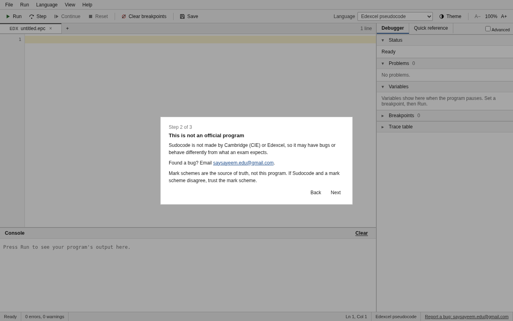

# Sudocode

**Write pseudocode, run it, and watch it work, one line at a time.**

[](https://sudocode.learnc.xyz)

[**Try it now: sudocode.learnc.xyz**](https://sudocode.learnc.xyz). Nothing to install. No account.

## What is Sudocode?

Sudocode is a free coding workspace for school computer science. You type a short program, press **Run**, and see what it does.

It understands three languages:

- Edexcel International GCSE (4CP0) pseudocode
- Cambridge 9618 (A Level) pseudocode
- Python (the part of Python that the syllabus uses)

_Pseudocode_ means "code written in plain, made-up-for-exams English". Normally you can only write it on paper. Sudocode lets a computer run it, so you can check your thinking.

## Who is it for?

- **Students** who want to see what their code really does.
- **Teachers** who want to show a program running, one step at a time.
- **Curious beginners.** You do not need to know how to code.

## Try it

**Easiest: open the website.** Go to [sudocode.learnc.xyz](https://sudocode.learnc.xyz). That is all.

**Run it on your own computer.** This takes about five minutes. You need to type five short lines into a _terminal_ (a window where you type commands).

1. Install [Node.js](https://nodejs.org) (version 26 or newer) and [Git](https://git-scm.com/downloads). They are free.
2. Open a terminal. On Windows, search for "PowerShell". On a Mac, search for "Terminal". Then copy and paste these lines, pressing Enter after each one:

   ```
   git clone https://github.com/humanspolluteearth/sudocode.git
   cd sudocode
   npm install --global pnpm
   pnpm install
   pnpm dev
   ```

3. Wait for a message that includes `Local: http://localhost:5173/`. That means it worked.
4. Open that address in your web browser. To stop, click the terminal and press `Ctrl` + `C`.

Stuck? See [SUPPORT.md](SUPPORT.md).

## What can it do?

**Run pseudocode and Python.** Press **Run** and the answer shows in the console.



**Step through line by line.** See every variable change, and a table that records each step.



**Check your code for mistakes.** Sudocode underlines problems and explains them in plain words, with a hint on how to fix them.

**Switch between languages.** Pick Edexcel, Cambridge or Python from the Language menu.



**Convert your program.** Turn Edexcel or Cambridge pseudocode into Python, or swap between the two pseudocode languages. A note tells you what changed. (Turn on **Advanced** to see this.)



**Quick reference guides.** Look up how to write a loop or an IF, and click **Insert** to add it to your code.



**Works on a phone or tablet.** The screen rearranges to fit.

 

**Works offline.** Open the website once, and it can be installed and used without the internet. It has no accounts and no tracking.

## How to use it

1. **Choose a language** from the Language menu.
2. **Type your program** in the big box. Not sure how? Open **Quick reference** and click **Insert**.
3. **Press Run.** Your output appears in the console. If the program asks a question, type your answer in the console.
4. **Press Step** to go through it one line at a time and watch the variables.
5. **Read any problems** listed on the right. They say what is wrong and how to fix it.

The full walk-through is in the [User guide](docs/USER-GUIDE.md).

## How does it work?

In very simple words:

1. You type a program.
2. Sudocode reads it and checks it for mistakes.
3. It runs it, one step at a time.
4. It shows you the result.

All three languages are turned into one shared inside format, so they can all run the same way. Converting is just reading that inside format and writing it out in another language.

Everything happens in your own browser. Your programs never leave your computer. There is more in [How it works](docs/HOW-IT-WORKS.md).

## Coming next

These are planned but **not built yet**:

- A desktop app for Windows, Mac and Linux
- An Android app
- More ways to convert between languages (for example, Python to pseudocode)

Details are in the [roadmap](docs/ROADMAP.md). The app and these pages are in English only. If you can help translate, open an [idea](https://github.com/humanspolluteearth/sudocode/issues/new?template=feature_request.yml).

## Found a bug?

Please tell us! You can:

- [Open a bug report on GitHub](https://github.com/humanspolluteearth/sudocode/issues/new?template=bug_report.yml), or
- Email [saysayeem.edu@gmail.com](mailto:saysayeem.edu@gmail.com)

Please include:

1. What you did
2. What you expected to happen
3. What happened instead
4. A screenshot, or the text of your program

## Want to help?

You do not need to code to help:

- Report bugs
- Suggest ideas
- Check that the language rules match your syllabus (use the "Language rule question" form)
- Fix a typo in these pages
- Tell your classmates and teachers

If you do code, read [CONTRIBUTING.md](CONTRIBUTING.md). Please be kind to each other: see our [Code of Conduct](CODE_OF_CONDUCT.md).

## A note about exams

**Sudocode is not an official Cambridge (CIE) or Edexcel program.** It is an independent project. It can have bugs, and it may not behave exactly as an exam expects.

- **Mark schemes are the source of truth.** If Sudocode and a mark scheme disagree, trust the mark scheme.
- **In your exam you write pseudocode by hand.** Use Sudocode to check your thinking, not to replace it. Try the answer on paper first, then run it here.



## Author and thanks

Made by Mahmudul Hasan Sayeem. Thank you to every student and teacher who tries it and tells us what to fix.

## Licence

You can use, share and change Sudocode for free, as long as anything you build from it is shared under the same licence. It is the [GNU AGPL-3.0](LICENSE).
