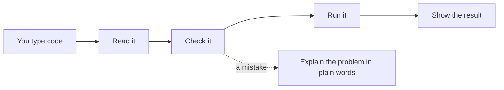
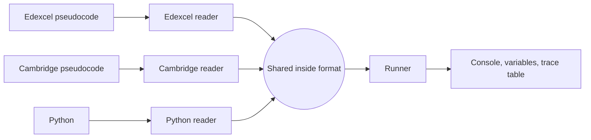
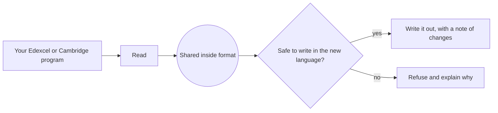

# How Sudocode works

A simple tour, then a section for developers.

## The short version

1. You type a program.
2. Sudocode **reads** it, and breaks it into pieces it understands.
3. It **checks** it for mistakes.
4. It **runs** it, one step at a time.
5. It **shows** you the result.

Everything happens inside your browser. Your programs are not sent anywhere.

## Three languages, one inside format

Edexcel pseudocode, Cambridge pseudocode and Python all look different. Sudocode has a separate "reader" for each one. Each reader turns your program into the **same shared inside format**. After that, one runner does the work for all three.

The shared format is careful about rules that differ between languages. For example, dividing whole numbers rounds down in one place and not in another. The inside format says which one it means, so each language keeps its own behaviour.

## How converting works

Converting uses the same inside format, backwards:

1. Read your program with the reader for its language.
2. Check that the inside format can be written out in the new language without changing what the program does.
3. Write it out in the new language.

If step 2 fails, Sudocode refuses and says why, rather than giving you a program that behaves differently.

## Why the runner can pause

The runner can stop at any line. That is how **Step**, breakpoints and **Stop** work. It runs in a background worker, so the page stays smooth even if your program is busy.

---

## For developers

Everything below is technical.

### Layout

| Folder                        | What it holds                                                                                     |
| ----------------------------- | ------------------------------------------------------------------------------------------------- |
| `packages/core`               | Lexers, parsers, checker, shared IR, runtime, debugger, converter. No browser APIs. Runs in Node. |
| `packages/ui`                 | The React app: editor (CodeMirror 6), console, debugger panels, settings                          |
| `apps/web`                    | The web shell (Vite) and its end-to-end tests                                                     |
| `apps/desktop`, `apps/mobile` | Placeholders for the planned shells                                                               |
| `docs/`                       | Spec, decisions, test plan, milestones, review notes                                              |

Dependencies point one way: `apps` to `ui` to `core`. The UI talks to the engine only through the `Runner` interface and the messages in `packages/core/src/protocol.ts`.

### Pipeline

- Hand-written lexers and recursive descent parsers, with a Pratt parser for expressions and panic-mode error recovery.
- A separate front end for each language, all lowering to one core IR whose nodes state language rules explicitly (for example `intDivFloor`).
- A generator-based tree-walking runtime in a Web Worker, pausable on any statement.
- Every token and node carries a `span` (line, column, start, end).
- Errors have the shape `{ code, line, column, message, hint, fix? }`.
- Converter: IR printers for Python, Edexcel and Cambridge.

### Where to read more

- [Language spec](language-spec/README.md) and the [converter spec](language-spec/converter.md)
- [Decisions](DECISIONS.md)
- [Test plan](TEST-PLAN.md)
- [Workflow](WORKFLOW.md) and [milestones](milestones/README.md)
- [Progress log](PROGRESS.md)
