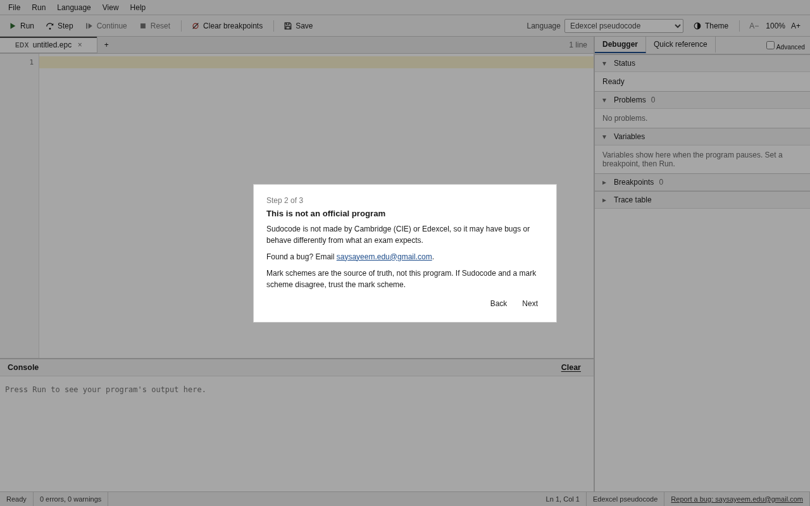
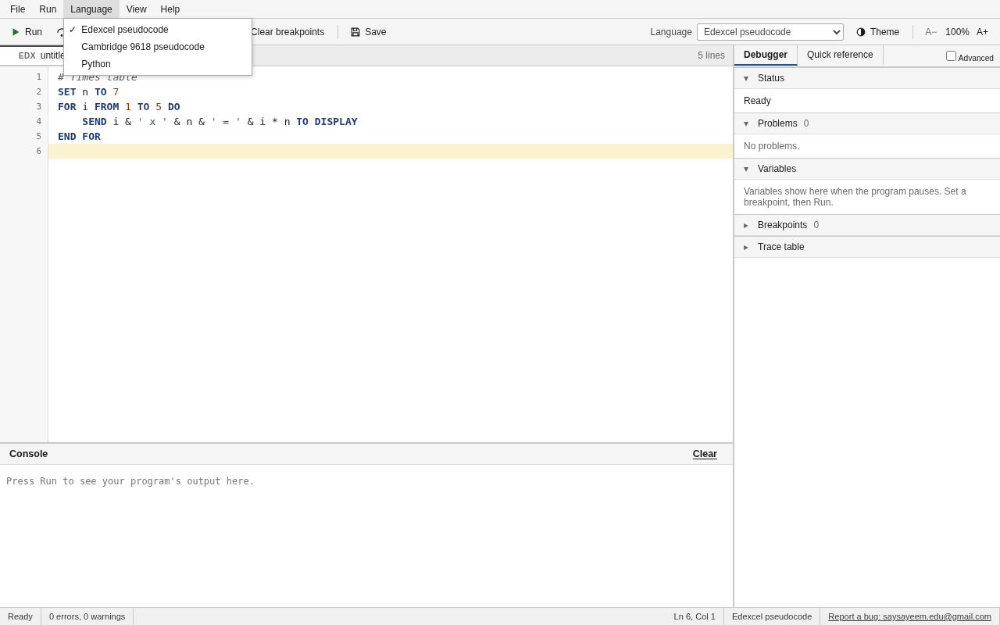
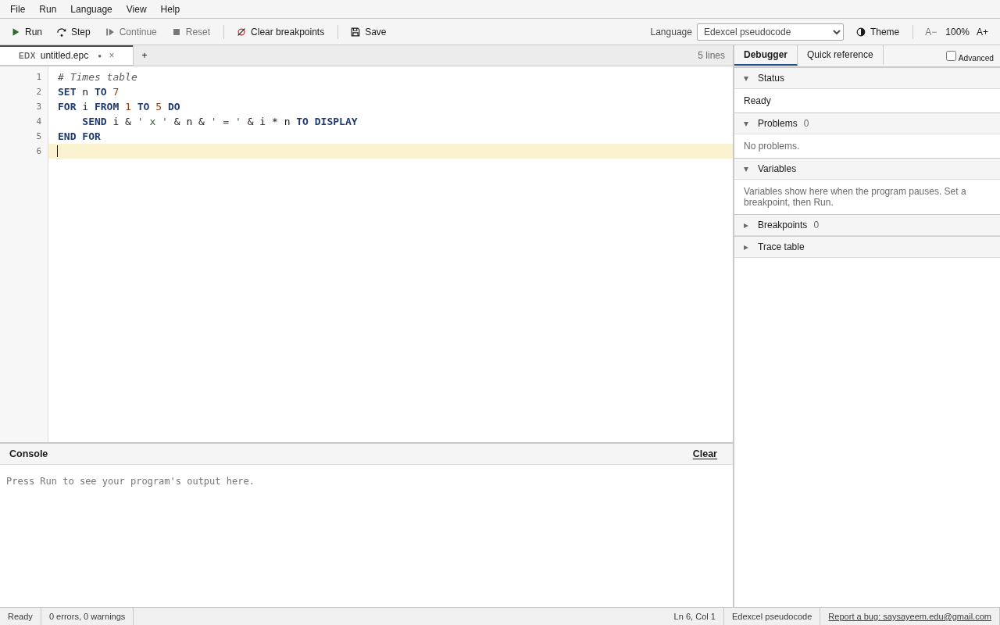
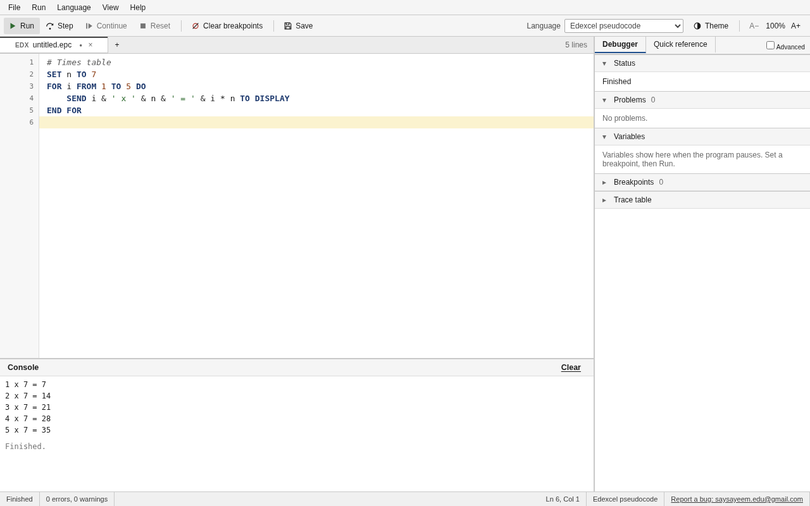
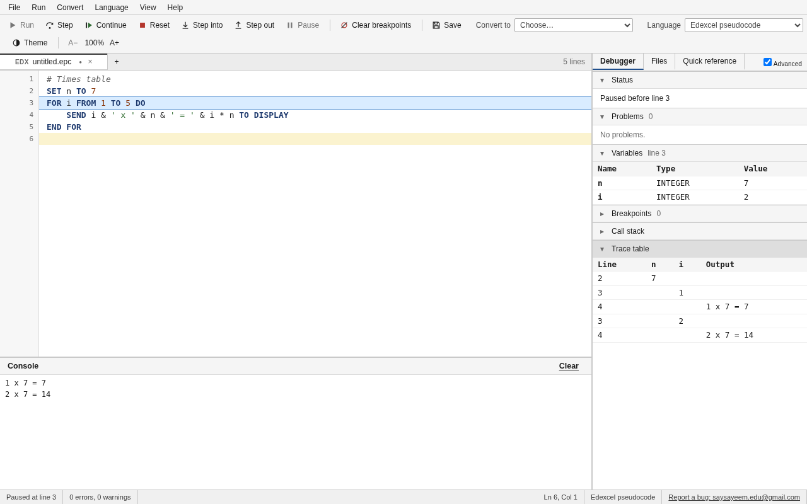
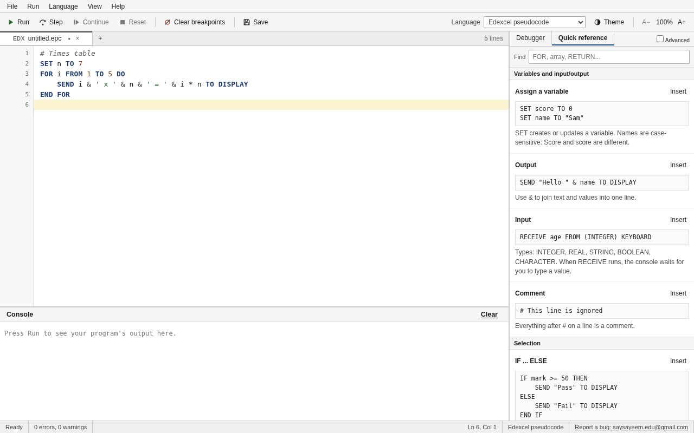
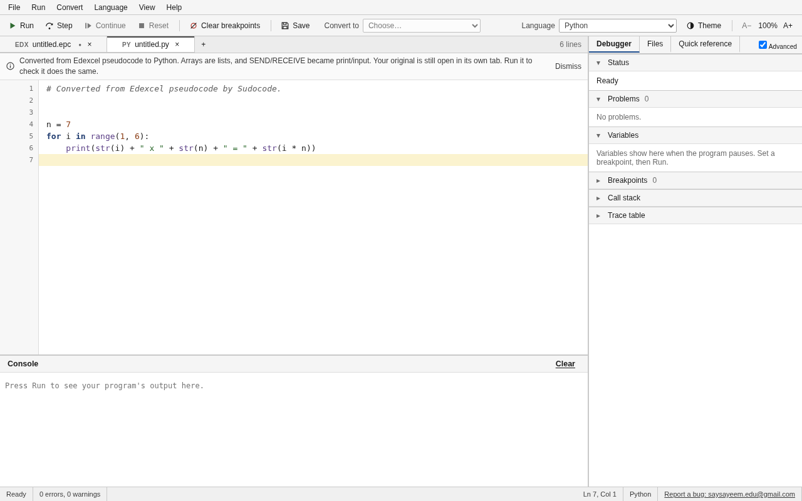
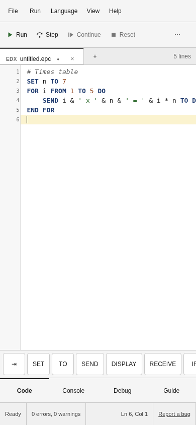
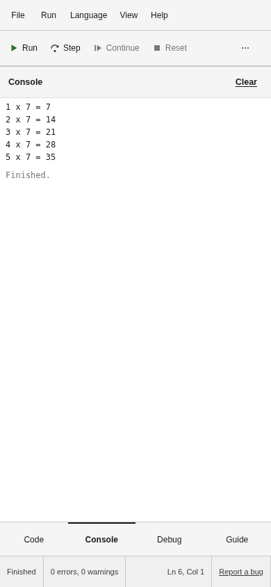
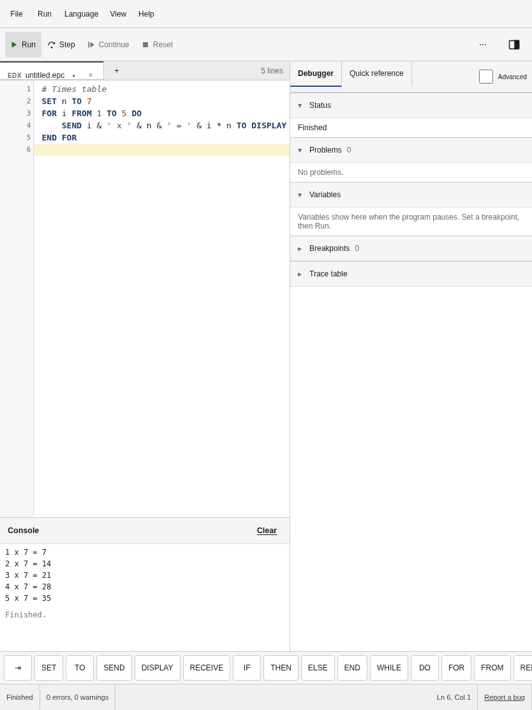

# User guide

How to use every part of Sudocode, step by step. New here? Start with the [README](../README.md).

Open the app at [sudocode.learnc.xyz](https://sudocode.learnc.xyz).

## Contents

1. [The first message](#1-the-first-message)
2. [Pick a language](#2-pick-a-language)
3. [Write a program](#3-write-a-program)
4. [Run it](#4-run-it)
5. [Step through it](#5-step-through-it)
6. [Fix mistakes](#6-fix-mistakes)
7. [Quick reference](#7-quick-reference)
8. [Convert a program](#8-convert-a-program)
9. [Save and open files](#9-save-and-open-files)
10. [Simple and Advanced mode](#10-simple-and-advanced-mode)
11. [Phone and tablet](#11-phone-and-tablet)
12. [Theme and text size](#12-theme-and-text-size)
13. [Keyboard shortcuts](#13-keyboard-shortcuts)

## 1. The first message

The first time you open Sudocode, a short message appears. It tells you that Sudocode is **not an official Cambridge or Edexcel program**, that **mark schemes are the source of truth**, and that **you must write pseudocode by hand in the exam**.

Press **Next** to read each step, then **Start coding**. Tick "Don't show this again" if you like. You can read it again any time from **Help > Welcome and disclaimer**.

## 2. Pick a language

Open the **Language** menu (or the Language box in the toolbar) and choose one:

- Edexcel pseudocode
- Cambridge 9618 pseudocode
- Python

The colours, the Quick reference and the error messages all change to match.

## 3. Write a program

Click in the big box and type. Line numbers are on the left. Keywords such as `SET` and `FOR` are coloured.

Tips:

- `Tab` indents. To leave the box with the keyboard, press `Escape` and then `Tab`.
- Lines that start with `#` are comments. The computer ignores them.
- Each language has its own rules. The [Quick reference](#7-quick-reference) shows examples.

## 4. Run it

Press **Run** (or `F5`). The output shows in the **Console** at the bottom.

- If the program asks for input, a box appears in the console. Type your answer and press `Enter`.
- Press **Stop** (or `Shift+F5`) to end a program early. **Clear** empties the console.
- A program that runs for a very long time stops itself and asks if you want to carry on. This protects slow devices.

## 5. Step through it

Press **Step** (or `F10`). The program runs one line and pauses. On the right you can see:

- **Status**: where it paused.
- **Variables**: every variable, its type and its value.
- **Trace table**: a table with one row for each step. Each variable has a column. This is the same kind of table you draw by hand in exams.

To pause at a chosen line, click the space next to its line number. A red dot appears. This is a **breakpoint**. Press **Run**, and the program stops there. Press **Continue** (`F8`) to go on, or **Reset** to start again.

In Advanced mode you also get **Step into** and **Step out** (to go inside a procedure or function and back out) and a **Call stack** panel.

## 6. Fix mistakes

Sudocode checks your code as you type.

- Problems are underlined in the editor.
- The **Problems** panel on the right lists them. Each one gives the line, a plain-words message and a hint.
- Some things are **warnings**, not errors. A warning means "this works, but it is not the official way". It shows you the official form.

Fix the first problem first. Often the others go away.

## 7. Quick reference

Open the **Quick reference** tab on the right (the **Guide** tab on a phone).

- Type in **Find** to search (for example `FOR`).
- Press **Insert** to put an example into your program.
- The page has a link to a longer guide for each language.

## 8. Convert a program

Turn on **Advanced** (see [below](#10-simple-and-advanced-mode)). A **Convert** menu appears.

What can be converted:

| From                 | To                              |
| -------------------- | ------------------------------- |
| Edexcel pseudocode   | Python, or Cambridge pseudocode |
| Cambridge pseudocode | Python, or Edexcel pseudocode   |
| Python               | Not offered                     |

The result opens in a **new tab**. Your original stays where it was. A note above the new code lists the important changes.

Some programs cannot be converted safely. When that happens, Sudocode tells you why and opens nothing.

## 9. Save and open files

- **File > Save** (`Ctrl+S`) saves your program. **Save as** (`Ctrl+Shift+S`) lets you choose a name.
- **File > Open** loads a file from your computer.
- **File > New file**, or the **+** button, opens a new tab. You can have many tabs.
- File endings: `.epc` is Edexcel, `.cpc` is Cambridge, `.py` is Python.

Programs that read and write text files use a small pretend file store inside the app. In Advanced mode it shows in the **Files** panel. It stays in your browser.

## 10. Simple and Advanced mode

Sudocode starts in **Simple** mode, with fewer buttons. Tick **Advanced** (top right of the side panel) for more:

| Feature                                   | Simple | Advanced |
| ----------------------------------------- | ------ | -------- |
| Editor, Run, Console                      | Yes    | Yes      |
| Problems and Quick reference              | Yes    | Yes      |
| Breakpoints, Step, Variables, Trace table | Yes    | Yes      |
| Step into, Step out, Call stack           | No     | Yes      |
| Files panel                               | No     | Yes      |
| Convert                                   | No     | Yes      |
| Settings for each tool                    | No     | Yes      |

In **View > Settings** you can switch each tool on or off.

## 11. Phone and tablet

On a **tablet**, the code, console and side panel sit together. Use **View > Side panel** to hide the panel.

On a **phone**, you see one view at a time. Use the buttons at the bottom: **Code**, **Console**, **Debug** and **Guide**. A row of keyword buttons (`SET`, `TO`, `IF`, ...) sits above the keyboard to save typing.

 

## 12. Theme and text size

- **Theme** switches between light, dark and "match my device".
- **A−** and **A+** change the text size from 100% to 150%.

## 13. Keyboard shortcuts

| Key                  | What it does                    |
| -------------------- | ------------------------------- |
| `F5`                 | Run                             |
| `Shift+F5`           | Stop                            |
| `F10`                | Step over (one line)            |
| `F8`                 | Continue                        |
| `F11` / `Shift+F11`  | Step into / Step out (Advanced) |
| `Ctrl+S`             | Save                            |
| `Ctrl+Shift+S`       | Save as                         |
| `Escape`, then `Tab` | Leave the editor                |

On a Mac, use `Cmd` instead of `Ctrl`.
